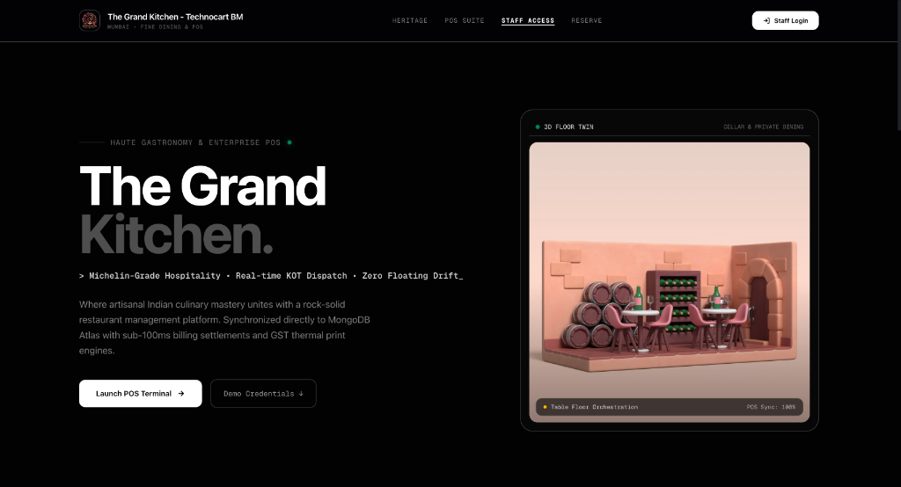
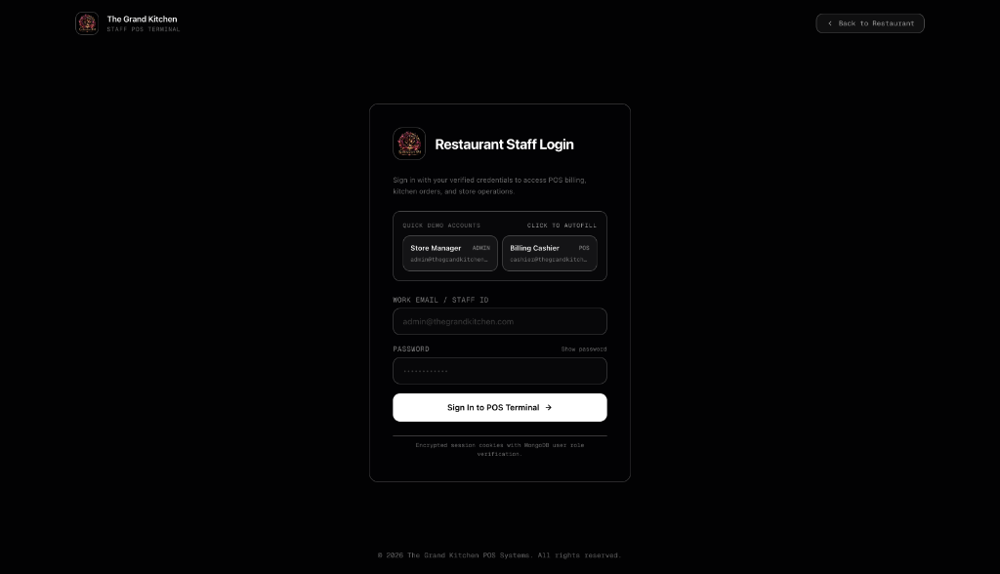
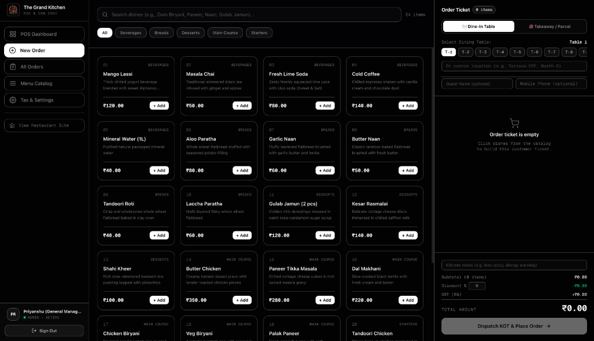
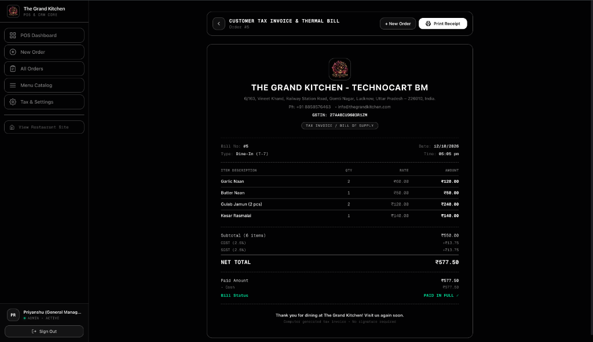
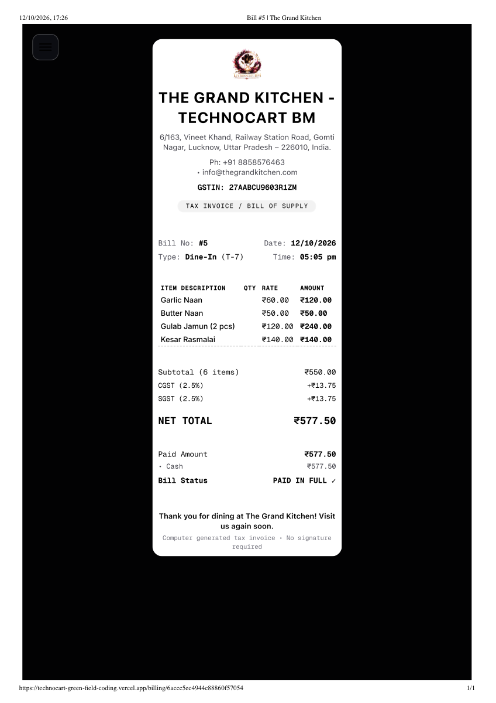

# 🍽️ The Grand Kitchen — User Operating Manual (How to Use)

Welcome to **The Grand Kitchen POS & Restaurant Management System**. This guide provides an easy, step-by-step operating sequence to navigate the platform, take orders, process kitchen tickets (KOT), settle bills, and print GST-compliant thermal tax invoices.

---

## 📑 Table of Contents
1. [Step 1: Accessing the Restaurant Portal](#step-1-accessing-the-restaurant-portal)
2. [Step 2: Staff Authentication & Roles](#step-2-staff-authentication--roles)
3. [Step 3: Creating an Order in the POS Terminal](#step-3-creating-an-order-in-the-pos-terminal)
4. [Step 4: Order Settlement & Invoice Generation](#step-4-order-settlement--invoice-generation)
5. [Step 5: 80mm Thermal Receipt Printing & PDF Sample](#step-5-80mm-thermal-receipt-printing--pdf-sample)
6. [Step 6: Menu Management & Store Settings (Admin)](#step-6-menu-management--store-settings-admin)
7. [Quick Navigation & Demo Credentials](#quick-navigation--demo-credentials)

---

## Step 1: Accessing the Restaurant Portal

When you open the application at the root address (`/`), you are greeted by the digital front-of-house landing page.

### Actions:
1. **Explore the Showcase**: View the brand heritage, Michelin-grade menu offerings, and the 3D dining twin.
2. **Access the POS Suite**:
   - Click **"Launch POS Terminal →"** in the hero banner, or
   - Click **"Staff Login"** / **"Staff Access"** in the top navigation bar.

---

## Step 2: Staff Authentication & Roles

To ensure high security, all operations (orders, billing, menu editing, and tax configurations) require a cryptographic HMAC-SHA256 session token stored in hardened HTTP-only cookies.

### How to Sign In:
For convenience during evaluation and demonstration, the login page features **1-Click Quick Autofill**:

| Role | Email | Password | Permissions |
| :--- | :--- | :--- | :--- |
| **Store Manager** *(ADMIN)* | `admin@thegrandkitchen.com` | `Admin@123` | Full Access: POS, Orders, Menu Management, GST & Store Settings, Analytics. |
| **Billing Cashier** *(POS)* | `cashier@thegrandkitchen.com` | `Cashier@123` | Operational Access: POS Order Terminal, Order Listing, Bill Settlement & Thermal Printing. |

1. Click on either **Store Manager** or **Billing Cashier** button to instantly populate credentials.
2. Click **"Sign In to POS Terminal →"**.
3. You will be redirected straight to the live POS Terminal (`/orders/new`).

---

## Step 3: Creating an Order in the POS Terminal

The POS Terminal allows rapid order booking designed for busy restaurant environments with zero lag and instant calculations.

### Sequence of Operation:

1. **Select Order Type & Dining Table**:
   - Choose **Dine-In Table** or **Takeaway / Parcel**.
   - For Dine-In, click any table quick-tag (**T-1** through **T-8**) or type a custom location in the input box (e.g., `Terrace-VIP`, `Booth-2`).
2. **Optional Customer Details**:
   - Enter **Guest Name** and **Mobile Phone** for CRM tracking and digital bill notifications.
3. **Select Menu Items**:
   - Filter items by category tabs: **All**, **Starters**, **Main Course**, **Breads**, **Desserts**, **Beverages**.
   - Or use the instant search bar to find dishes (e.g., `Biryani`, `Naan`, `Paneer`).
   - Click **"+ Add"** on any dish card to add it to the active ticket on the right.
4. **Adjust Quantities & Discounts**:
   - In the right-hand **Order Ticket**, click `+` or `-` to adjust quantities, or trash can to remove an item.
   - Enter an optional discount percentage (e.g., `10%`). Subtotal, GST, and Net Total update in real-time using exact integer-paise calculations (preventing any floating-point math errors).
5. **Kitchen Instructions**:
   - Add specific preparation instructions in **Kitchen notes** (e.g., `Less spicy, make naan extra crisp`).
6. **Dispatch Order**:
   - Click **"Dispatch KOT & Place Order →"**.
   - The order is instantly created in MongoDB Atlas, given an auto-incremented Order Number, and placed in `active` status.

---

## Step 4: Order Settlement & Invoice Generation

Once dining is complete or food is served, proceed to payment collection and receipt generation.

### Sequence of Operation:
1. Navigate to **"All Orders"** (`/orders`) from the left sidebar and select the order, or click directly into the order detail view.
2. In the order details:
   - You can mark dishes as served or cancel items if needed.
   - Click **"Record Payment"** and choose payment method:
     - 💵 **Cash**
     - 📱 **UPI / QR Code**
     - 💳 **Credit / Debit Card**
     - 🌐 **Net Banking**
3. Once settled, the order status changes to **"Completed / Paid in Full"**.
4. Click **"View Customer Invoice"** to open the tax invoice view (`/billing/[id]`).

---

## Step 5: 80mm Thermal Receipt Printing & PDF Sample

The system features an automated print stylesheet formatted specifically for standard **80mm (3-inch) ESC/POS thermal receipt printers** with restaurant branding, legal GSTIN, split tax tables, and customer greetings.

### Printing the Bill:
1. On the invoice page (`/billing/[id]`), click the top-right button: **"🖨️ Print Receipt"**.
2. Your browser's print dialog will open automatically:
   - **Destination**: Choose your thermal printer (or select **"Save as PDF"**).
   - **Layout**: Portrait.
   - **Margins**: None / Minimum (the CSS automatically handles margins and 80mm centering).
3. Click **Print**.

### 📄 Attached PDF Sample:
You can inspect the exact sample PDF generated by the system here:
- **Direct Repository File**: [docs/assets/05-sample-thermal-receipt.pdf](docs/assets/05-sample-thermal-receipt.pdf)
- **Web-Served Asset**: [/docs/05-sample-thermal-receipt.pdf](public/docs/05-sample-thermal-receipt.pdf)

---

## Step 6: Menu Management & Store Settings (Admin)

When logged in with the **Store Manager (ADMIN)** account, additional store administration features become available in the sidebar:

### 1. Menu Catalog (`/menu`)
- **Add New Dish**: Click **"+ Add New Dish"** to create a menu item with custom price, category, description, image URL, and sort order.
- **Stock Availability**: Toggle any item's availability switch to instantly show or hide it from the cashier POS terminal.
- **Edit / Delete**: Update item prices or remove retired dishes.

### 2. Tax & Store Settings (`/settings`)
- **Restaurant Details**: Update official store name, physical address, contact phone, and email.
- **GST Compliance**: Configure your official 15-character **GSTIN** number.
- **Tax Breakdown**: Modify default tax percentage (e.g., standard 5% GST split into 2.5% CGST + 2.5% SGST) and optional service charge percentage.
- **Thermal Footer**: Customize the closing thank-you note printed at the bottom of all customer receipts.

---

## Quick Navigation & Demo Credentials

### Primary Routes
- **Public Restaurant Landing**: [`/`](http://localhost:3000/)
- **Staff Login**: [`/login`](http://localhost:3000/login)
- **POS New Order Terminal**: [`/orders/new`](http://localhost:3000/orders/new)
- **Live Orders List**: [`/orders`](http://localhost:3000/orders)
- **Menu Management** *(Admin)*: [`/menu`](http://localhost:3000/menu)
- **Store & GST Settings** *(Admin)*: [`/settings`](http://localhost:3000/settings)

### Demo Accounts Summary
- **Administrator**: `admin@thegrandkitchen.com` / `Admin@123`
- **Cashier**: `cashier@thegrandkitchen.com` / `Cashier@123`

---
*The Grand Kitchen POS System — Engineered with Next.js 16, TypeScript, Tailwind CSS & MongoDB Atlas.*
